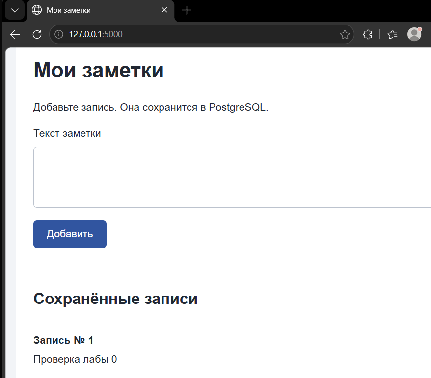
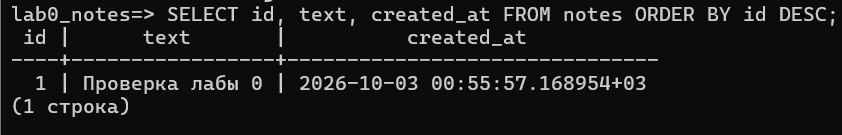

# Лабораторная работа 0

Приложение добавляет заметки через форму и показывает сохранённые записи. После обновления страницы они остаются в списке, тк хранятся в PostgreSQL.

## Состав

- **Бэкенд:** Python 3.13 и Flask. `POST /api/notes` сохраняет заметку, `GET /api/notes` читает записи из базы.
- **Фронтенд:** HTML, CSS и JavaScript. Форма и список работают с бэкендом через `fetch`.
- **База данных:** PostgreSQL 18.6, запущенный отдельно от приложения. Таблица `notes` содержит поля `id`, `text`, `created_at`.

## Запуск

Инструкция для PowerShell. Все команды выполняются из папки `lab0`
1. Подключитесь к PostgreSQL под пользователем `postgres`, чтобы создать пользователя приложения и базу:

   ```powershell
   psql -h 127.0.0.1 -p 5432 -U postgres
   ```

   В `psql` создайте пользователя и базу, заменив поле `свой_пароль`:

   ```sql
   CREATE USER lab0_user WITH PASSWORD 'свой_пароль';
   CREATE DATABASE lab0_notes OWNER lab0_user;
   ```

   Для выхода из `psql` введите `\q`.

2. Создайте `.env` из шаблона и укажите в `DB_PASSWORD` пароль пользователя `lab0_user`:

   ```powershell
   Copy-Item .env.example .env
   ```


3. Установите зависимости, создайте таблицу и запустите приложение:

   ```powershell
   py -3.13 -m venv .venv
   .\.venv\Scripts\python.exe -m pip install -r requirements.txt
   .\.venv\Scripts\python.exe -m flask --app app init-db
   .\.venv\Scripts\python.exe -m flask --app app run --host 127.0.0.1 --port 5000
   ```

   При повторном запуске достаточно последней команды, если PostgreSQL уже работает и таблица создана

## Скриншоты

Заметка № 1 после обновления страницы:



Та же запись в PostgreSQL:


