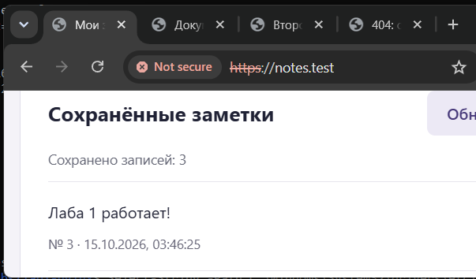
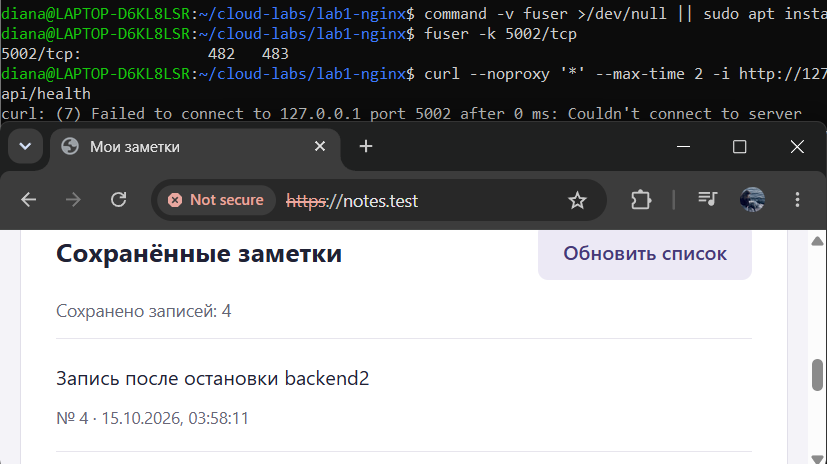
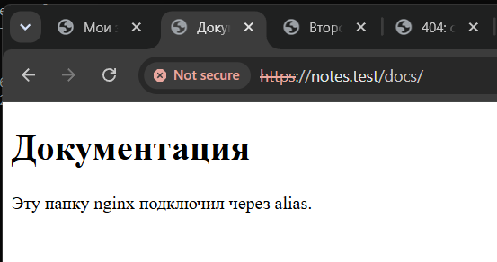
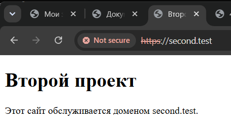
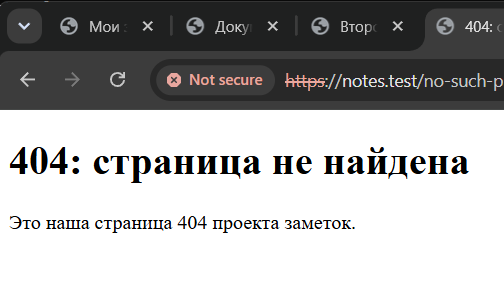

# Лабораторная работа 1

nginx стоит перед приложением с заметками из лабораторной 0: отдаёт фронтенд и распределяет запросы к API между двумя бэкендами. nginx и бэкенды работают в Ubuntu через WSL, PostgreSQL остался в Windows.

Сайты работают локально и недоступны при выключенном ноутбуке: `https://notes.test/` и `https://second.test/`.

## Состав

- **nginx:** HTTPS с самоподписанным сертификатом, редирект HTTP → HTTPS, раздача фронтенда и проксирование `/api/` с балансировкой между двумя бэкендами.
- **Бэкенд:** два экземпляра Flask через Gunicorn на портах `5001` и `5002`. Заголовок `X-Backend-ID` в ответе API показывает, какой экземпляр ответил.
- **База данных:** PostgreSQL в Windows, прежние база `lab0_notes` и пользователь `lab0_user`.

Также настроены `/docs/` через `alias`, отдельный сайт `second.test`, ограничение запросов с ответом `429`, своя страница `404`, Basic Auth на `/admin` (логин `labadmin`) и ответ `421` для неизвестного домена.

Основные файлы: [конфигурация nginx](nginx/nginx.conf), [настройки проксирования API](nginx/proxy-api.conf), [скрипт проверки](check.sh).

## Запуск

Команды выполняются в **Ubuntu (WSL)** из папки `lab1`, если не указано иное. Нужны nginx, Python 3 с `venv`, OpenSSL и `htpasswd` (пакет `apache2-utils`). PostgreSQL должен быть запущен в Windows и принимать подключения из WSL.

1. В Windows добавьте в файл `C:\Windows\System32\drivers\etc\hosts` строку:

   ```text
   127.0.0.1 notes.test second.test
   ```

2. Создайте `backend/.env` с параметрами подключения. В `DB_HOST` укажите адрес Windows, доступный из WSL; он может измениться после перезапуска WSL. Пароль должен совпадать с паролем `lab0_user` в PostgreSQL.

   ```dotenv
   DB_HOST=<адрес_Windows_из_WSL>
   DB_PORT=5432
   DB_NAME=lab0_notes
   DB_USER=lab0_user
   DB_PASSWORD=<пароль_lab0_user>
   ```

3. Подготовьте Python и таблицу `notes` в первом терминале Ubuntu:

   ```bash
   cd backend
   python3 -m venv .venv
   .venv/bin/python -m pip install -r requirements.txt
   .venv/bin/python -m flask --app app init-db
   INSTANCE_ID=backend-1 .venv/bin/gunicorn --workers 1 --bind 127.0.0.1:5001 app:app
   ```

   Во втором терминале, открытом в папке `lab1`, запустите второй экземпляр:

   ```bash
   cd backend
   INSTANCE_ID=backend-2 .venv/bin/gunicorn --workers 1 --bind 127.0.0.1:5002 app:app
   ```

4. Скопируйте конфигурацию и статические файлы nginx из папки `lab1`:

   ```bash
   sudo install -d /etc/nginx/lab1/tls /srv/lab1/notes /srv/lab1/docs /srv/lab1/admin /srv/lab1/second
   sudo install -m 644 nginx/nginx.conf /etc/nginx/nginx.conf
   sudo install -m 644 nginx/proxy-api.conf nginx/star-enabled.conf /etc/nginx/lab1/
   sudo cp -a frontend/. /srv/lab1/notes/
   sudo cp -a content/docs/. /srv/lab1/docs/
   sudo cp -a content/admin/. /srv/lab1/admin/
   sudo cp -a second/. /srv/lab1/second/
   ```

   Если локальные сертификат и файл паролей ещё не созданы, создайте их один раз. Пароль для `labadmin` команда `htpasswd` запросит в терминале:

   ```bash
   sudo openssl req -x509 -newkey rsa:2048 -nodes -sha256 -days 365 \
     -keyout /etc/nginx/lab1/tls/lab1.key \
     -out /etc/nginx/lab1/tls/lab1.crt \
     -subj '/CN=notes.test' \
     -addext 'subjectAltName=DNS:notes.test,DNS:second.test'
   sudo chmod 600 /etc/nginx/lab1/tls/lab1.key
   sudo htpasswd -c /etc/nginx/lab1/.htpasswd labadmin
   ```

   Проверьте конфигурацию и перезапустите nginx:

   ```bash
   sudo nginx -t
   sudo service nginx restart
   ```

Браузер предупредит о самоподписанном сертификате. Скрипт `check.sh` проверяет его по локальному файлу `/etc/nginx/lab1/tls/lab1.crt`.

## Проверка

При работающих двух бэкендах выполните из `lab1`:

```bash
bash check.sh normal
```

В сохранённом прогоне — **PASS=37 FAIL=0**. Десять запросов к API чередовались между `backend-1` и `backend-2`; из 40 запросов проверки лимита 15 получили `200`, 25 — `429`. Полный вывод: [check-normal.txt](report/evidence/check-normal.txt).

Для проверки отказоустойчивости остановите `backend-2` и выполните:

```bash
bash check.sh failover backend-1
```

Результат — **PASS=4 FAIL=0**: фронтенд и чтение заметок вернули `200`, все 10 запросов к API получили `X-Backend-ID: backend-1`. Вывод: [check-failover.txt](report/evidence/check-failover.txt). После повторного запуска второго экземпляра сохранена [проверка восстановления](report/evidence/check-restored.txt) с **PASS=37 FAIL=0**.

Дополнительные выводы: [проверка конфигурации nginx](report/evidence/nginx-test.txt), [инициализация таблицы](report/evidence/init-db.txt), [лог второго бэкенда](report/evidence/backend-2.log).

## Скриншоты

`notes.test`: запись № 3 «Лаба 1 работает!»:



После остановки `backend-2`: запись № 4 «Запись после остановки backend2»:



`/docs/` — страница «Документация»:



`second.test` — страница «Второй проект»:



Собственная страница «404: страница не найдена»:


