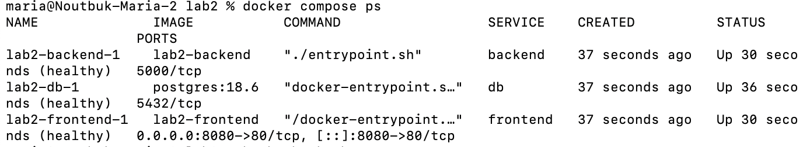
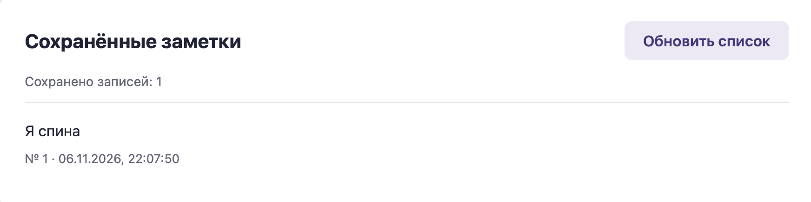

# Лабораторная работа № 2. Docker

## Цель работы

Упаковать сервис заметок из лабораторной № 0 в Docker, сравнить два Dockerfile бэкенда и запустить приложение целиком через Docker Compose.

## Что собрано

- `frontend` — nginx отдаёт интерфейс и проксирует `/api/` на `backend:5000`. С хоста доступен порт `8080`.
- `backend` — Flask под Gunicorn обрабатывает запросы и подключается к PostgreSQL по адресу `db:5432`.
- `db` — PostgreSQL 18.6. Данные хранятся в именованном томе `db_data`, который смонтирован в `/var/lib/postgresql`.

В сети `frontend-net` находятся nginx и бэкенд, в `backend-net` — бэкенд и PostgreSQL. Бэкенд подключён к обеим сетям. Порты бэкенда и базы на хосте не опубликованы. Compose запускает бэкенд после успешного `pg_isready` у базы. Проверки состояния nginx и приложения заданы в их образах.

Файлы реализации — [Dockerfile.bad](backend/Dockerfile.bad), [Dockerfile.good](backend/Dockerfile.good), [.dockerignore](backend/.dockerignore), [Dockerfile фронтенда](frontend/Dockerfile), [конфигурация nginx](frontend/conf.d/default.conf) и [docker-compose.yml](docker-compose.yml).

## Сравнение Dockerfile

| Практика | `Dockerfile.bad` | `Dockerfile.good` |
| --- | --- | --- |
| Базовый образ | Плавающий тег `python:latest` может сменить версию Python между сборками | Оба этапа используют `python:3.13.0-slim` |
| Пароль БД | Демонстрационный пароль записан в `ENV` и попадает в конфигурацию образа | Compose передаёт `DB_PASSWORD` при запуске |
| Кеш и контекст | `COPY . .` выполняется до `pip install`: изменение файла приложения сбрасывает кеш установки | Сначала копируется `requirements.txt` и устанавливаются зависимости. Затем отдельно копируются файлы приложения. Общий `.dockerignore` фильтрует контекст обеих сборок |
| Пользователь | По умолчанию `root` | Инструкция `USER appuser` задаёт непривилегированного пользователя |
| Проверка состояния | Проверки в образе нет | `HEALTHCHECK` вызывает `/api/health`, где приложение выполняет `SELECT 1` |
| Состав образа | Одноэтапная сборка, возможное сохранение кеша pip | Зависимости ставятся в `builder` с `--no-cache-dir`. В финальный образ копируются установленные зависимости и файлы запуска |
| HTTP-сервер | Встроенный сервер Flask | Gunicorn с двумя воркерами |

Собранный образ `lab2-backend:good` занимал **251 MB** по выводу `docker images`. Сборка с уже заполненным кешем заняла **1,4 с**. BuildKit отметил слой `pip install` как `CACHED`. [Вывод сборки](screenshots/good_and_bad_build_2.png)

В сохранённом прогоне сборка по `Dockerfile.bad` остановилась на `pip install`. Для версии Python из `python:latest` pip не нашёл совместимый пакет `psycopg-binary==3.3.5`. [Скриншот ошибки сборки](screenshots/good_and_bad_build.png)

## Запуск и результат

Из корня репозитория перейдите в `lab2` и подготовьте `.env` по образцу [.env.example](.env.example).

```sh
cd lab2
test -f .env || cp .env.example .env
```

Укажите локальный пароль PostgreSQL вместо `CHANGE_ME` в `.env`, затем запустите стек.

```sh
docker compose up -d --build --wait
docker compose ps
```

Страница приложения доступна по адресу <http://127.0.0.1:8080>. В сохранённом выводе `docker compose ps` все три контейнера имеют статус `healthy`. На странице отображается сохранённая заметка № 1.




