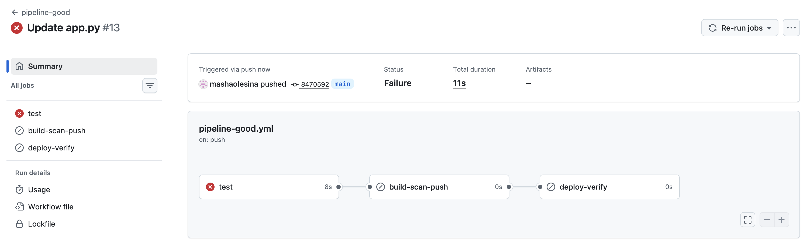
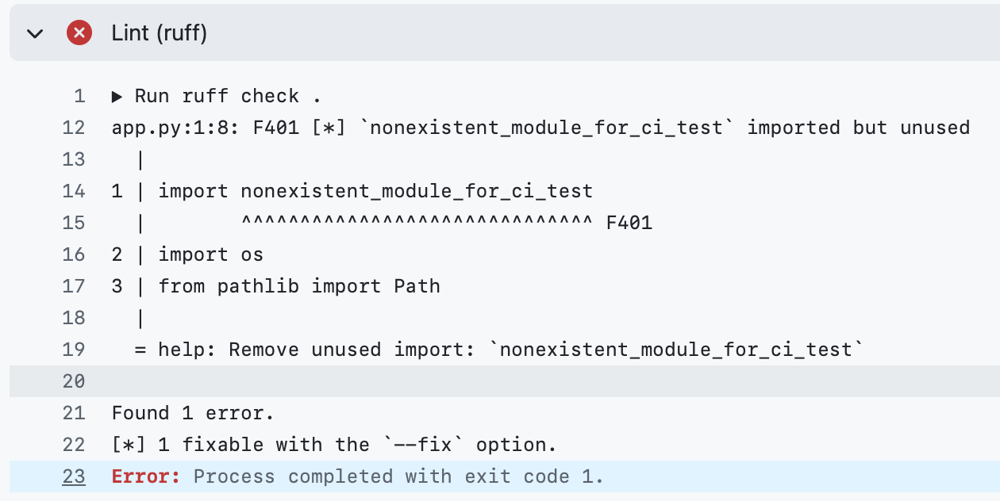
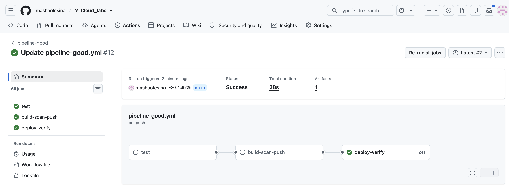
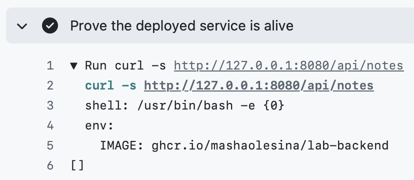

# Лабораторная работа № 3. CI/CD

## Цель работы

Настроить CI/CD для сервиса заметок из лабораторных № 0 и № 2. Проверки кода и образа должны блокировать публикацию при ошибке. После успешных проверок пайплайн публикует образ, запускает стек и проверяет API.

## Устройство пайплайнов

Исходные файлы — [pipeline-bad.yml](../.github/workflows/pipeline-bad.yml), [pipeline-good.yml](../.github/workflows/pipeline-good.yml), [Dockerfile бэкенда](backend/Dockerfile.good) и [Compose для CI](docker-compose.ci.yml). В lab3 используется та же двухэтапная схема сборки бэкенда, что и в [lab2](../lab2/README.md), с обновлённым базовым образом.

| Практика | `pipeline-bad` | `pipeline-good` |
| --- | --- | --- |
| Версии | `actions/checkout@master` зависит от текущего состояния ветки | У Actions указаны теги версий, например `checkout@v4`, `build-push-action@v6` и `trivy-action@v0.36.0`. База Python указана тегом `3.13-slim-bookworm` |
| Проверка кода | Нет lint и unit-тестов | `test` запускает Ruff и pytest. Сборка зависит от успешного `test` |
| Пароль БД | Демонстрационное значение прописано в YAML как аргумент сборки | `deploy-verify` получает пароль из `secrets.DB_PASSWORD` и передаёт его Compose при запуске |
| Кеш | Между прогонами кеш не сохраняется | `setup-python` кеширует зависимости pip, Buildx читает и сохраняет слои через `type=gha` |
| Сканирование | Шаг публикации выполняется без сканирования | Trivy выводит `HIGH` и `CRITICAL` отдельным отчётом. Проверка `CRITICAL` блокирует публикацию при наличии исправляемых критических находок |
| Тег образа | В шаге публикации указан только `:latest` | Тег содержит SHA коммита, по нему можно выбрать образ конкретной сборки |
| Деплой | Шаг выводит сообщение о деплое | Compose поднимает стек из опубликованного образа. Пайплайн проверяет `/api/health` и `/api/notes` |

Хороший workflow запускается при push в `main` или вручную. Последовательность задана через `needs`: `test` → `build-scan-push` → `deploy-verify`. Результаты демонстраций ниже получены в форке `mashaolesina/Cloud_labs`. Коммиты и скриншоты вошли в основной репозиторий через [PR № 1](https://github.com/befovis/Cloud_labs/pull/1).

## 1. Ошибка lint блокирует деплой

В коммите `8470592` в `lab3/backend/app.py` добавили неиспользуемый импорт `nonexistent_module_for_ci_test`. Ruff выдал `F401` и завершился с кодом `1`. GitHub Actions пропустил pytest, `build-scan-push` и `deploy-verify`. Импорт удалили в `4bc940a`, после чего прогон прошёл успешно. [Красный прогон](https://github.com/mashaolesina/Cloud_labs/actions/runs/43436796434) · [Прогон после удаления импорта](https://github.com/mashaolesina/Cloud_labs/actions/runs/43436969294)





## 2. Trivy блокирует публикацию образа

Оба этапа сборки сначала использовали `python:3.13.0-slim-bookworm`. Trivy определил Debian 12.8, нашёл семь исправляемых уязвимостей уровня `CRITICAL` и завершил проверку кодом `1`. Шаги входа в GHCR, публикации и деплоя были пропущены. Затем в обоих этапах базу обновили до `python:3.13-slim-bookworm`. В повторном прогоне Trivy определил Debian 12.15 и пропустил образ к публикации. [Заблокированный скан](https://github.com/mashaolesina/Cloud_labs/actions/runs/43438244715/job/131928916735) · [Скан после обновления](https://github.com/mashaolesina/Cloud_labs/actions/runs/43439539804/job/131933353341)

| Цель сканирования | HIGH до | CRITICAL до | HIGH после | CRITICAL после |
| --- | ---: | ---: | ---: | ---: |
| Debian | 41 | 7 | 0 | 0 |
| Пакеты Python | 0 | 0 | 5 | 0 |
| **Всего** | **41** | **7** | **5** | **0** |

Сканирование выполнялось с `ignore-unfixed: true`. После обновления базового образа Trivy нашёл пять уязвимостей `HIGH` в `msgpack`, `setuptools` и `urllib3`. Эксперимент ограничивался обновлением базового образа. Блокирующая проверка настроена на `CRITICAL`.

[Скриншот блокирующего скана](<screenshots/Scan_Image_(Trivy).png>) · [Сводка HIGH и CRITICAL до обновления](screenshots/high_and_critical_bad.png) · [Сводка по пакетам Python после обновления](screenshots/high_and_critical_good.png)

## 3. Успешный деплой и проверка API

После обновления базы прогон на коммите `82fc9df` прошёл все три этапа. Бэкенд был опубликован в GHCR с тегом коммита. `deploy-verify` поднял из него бэкенд, собрал frontend и запустил PostgreSQL на runner GitHub Actions. В логе сначала появился ответ проверки готовности, затем пустой список заметок из новой базы. В конце прогона стек удалён шагом `Tear down`. [Зелёный прогон после обновления](https://github.com/mashaolesina/Cloud_labs/actions/runs/43439539804) · [Лог деплоя и curl](https://github.com/mashaolesina/Cloud_labs/actions/runs/43439539804/job/131933840641)

```text
GET /api/health → {"database":"ok","status":"ok"}
curl -s http://127.0.0.1:8080/api/notes
[]
```

Скриншоты показывают результаты более раннего успешного прогона № 12. [Прогон № 12](https://github.com/mashaolesina/Cloud_labs/actions/runs/43435232380)





## Локальное воспроизведение

Из корня репозитория установите зависимости и запустите Ruff и pytest.

```sh
python3 -m venv lab3/.venv
lab3/.venv/bin/python -m pip install -r lab3/backend/requirements-dev.txt
(
  cd lab3/backend
  ../.venv/bin/ruff check .
  PYTHONPATH=. ../.venv/bin/python -m pytest -q
)
```

Для запуска приложения через Docker Compose подготовьте `lab3/.env` по образцу [.env.example](.env.example).

```sh
test -f lab3/.env || cp lab3/.env.example lab3/.env
```

Укажите локальный пароль PostgreSQL вместо `CHANGE_ME` в `lab3/.env`, затем соберите и запустите стек.

```sh
docker build -f lab3/backend/Dockerfile.good -t cloud-labs-lab3-backend:local lab3/backend
export BACKEND_IMAGE=cloud-labs-lab3-backend:local
docker compose -p cloud-labs-lab3 -f lab3/docker-compose.yml --env-file lab3/.env up -d --build --wait
curl -fsS http://127.0.0.1:8080/api/health
curl -fsS http://127.0.0.1:8080/api/notes
```

Интерфейс доступен на <http://127.0.0.1:8080>.
